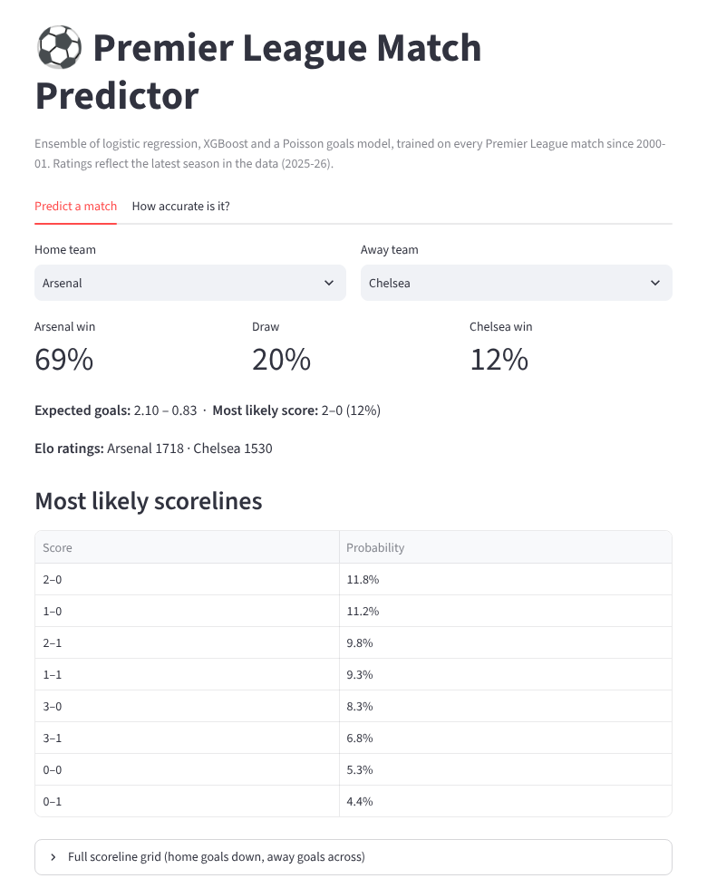
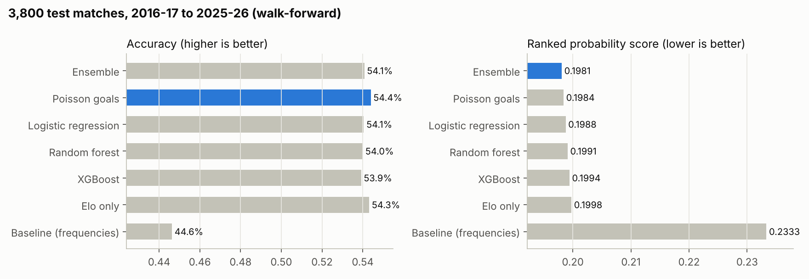
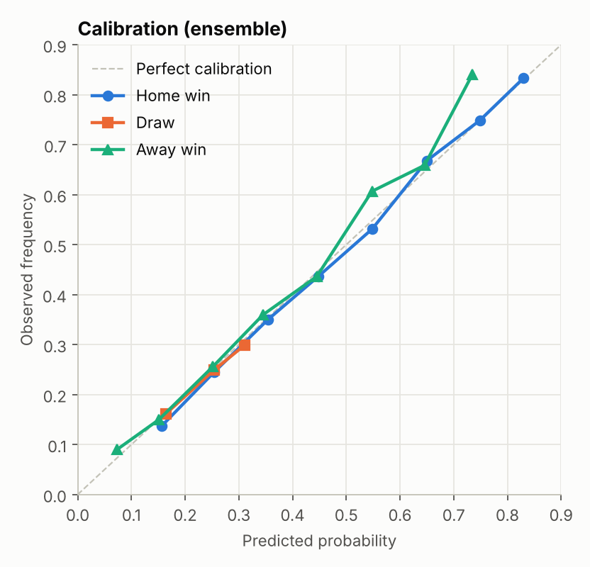
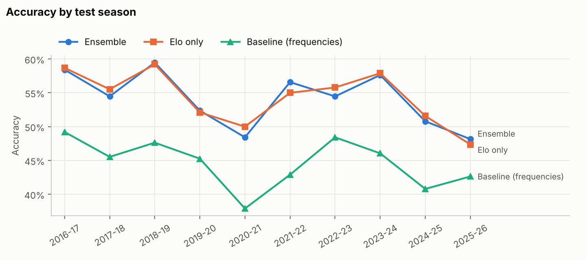
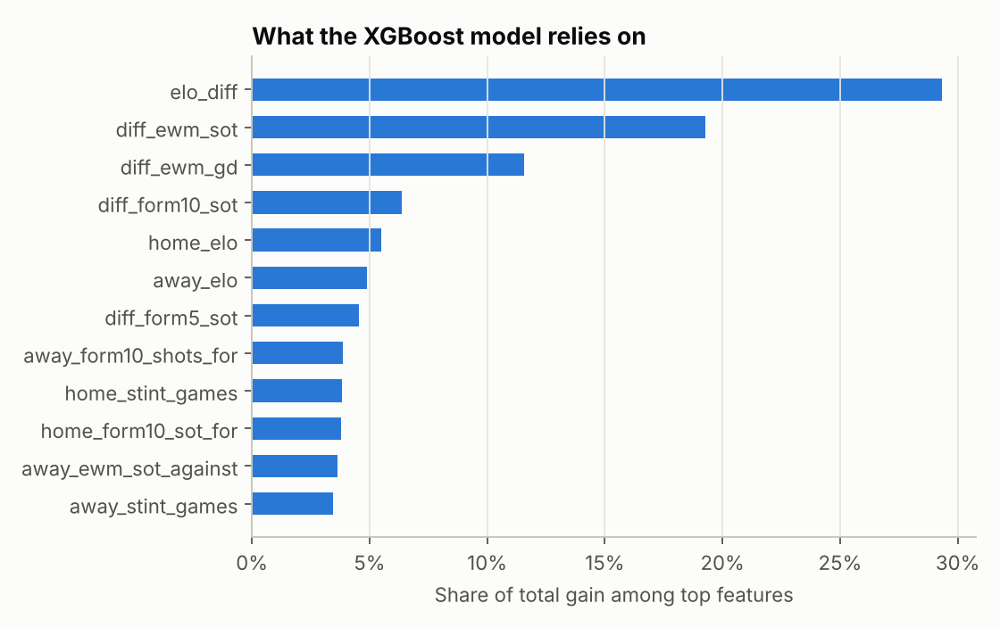

# ⚽ Premier League Match Predictor

Predicts the result **and the most likely scoreline** of Premier League matches, and compares six
machine-learning approaches on 10 seasons of unseen games.


| | |
|---|---|
| **Data** | 12,700+ matches, every Premier League season 1993-94 to 2025-26 |
| **Evaluation** | Walk-forward backtest on **3,800 matches** (2016-17 to 2025-26); each season predicted using only earlier seasons |
| **Best accuracy** | **54.4%** (Poisson goals model) vs 44.6% for a no-skill baseline |
| **Best probability quality** | **0.198 RPS** (ensemble of logistic regression + XGBoost + Poisson) |
| **Scorelines** | Exact score correct in **11.9%** of matches; total goals within **1.3** on average |

<p align="center"></p>

## Results



| Model | Accuracy | Log loss | Brier | RPS ↓ |
|---|---|---|---|---|
| **Ensemble** (LogReg + XGBoost + Poisson) | 54.1% | **0.966** | **0.573** | **0.1981** |
| Poisson goals model | **54.4%** | 0.966 | 0.573 | 0.1984 |
| Logistic regression | 54.1% | 0.970 | 0.575 | 0.1988 |
| Random forest | 54.0% | 0.970 | 0.575 | 0.1991 |
| XGBoost | 53.9% | 0.971 | 0.576 | 0.1994 |
| Elo rating only | 54.3% | 0.971 | 0.576 | 0.1998 |
| Baseline (historical H/D/A frequencies) | 44.6% | 1.067 | 0.645 | 0.2333 |

**Why RPS?** The [ranked probability score](https://en.wikipedia.org/wiki/Scoring_rule#Ranked_probability_score)
is the standard metric for football forecasts. Outcomes are ordered (home win > draw > away win), so
predicting a draw when the home side wins is penalized less than predicting an away win. It also scores
the *probabilities*, not just the top pick, which matters for any real use (betting markets, fantasy, media).

### What I learned

1. **A single number does most of the work.** One Elo rating difference already reaches 54.3% accuracy.
   The 40+ form features mostly improve *probability quality* (RPS 0.1998 → 0.1981), not the hit rate.
2. **Fancier models didn't win.** XGBoost and random forests did not beat logistic regression. With ~10k
   training games and a mostly linear signal, extra model capacity mostly fits noise. Averaging
   different model families (the ensemble) helped more than making any single model complex.
3. **Draws are the hard part.** 25.6% of matches end level, but a draw is almost never the *single most
   likely* outcome, so every model predicts a draw in under 1% of games. That caps accuracy for every
   approach, which is why probability-based metrics are the fairer comparison.
4. **COVID removed home advantage.** In 2020-21, played without fans, home teams won only 37.9% of games
   (vs ~46% normally). Every model had its worst season (RPS 0.220 for the ensemble), because they had all
   learned a home advantage that briefly disappeared.
5. **The probabilities are well calibrated.** When the ensemble says 60%, the event happens about 60% of the time:

<p align="center"></p>



## How it works

```
raw CSVs ──► data.py ──► elo.py ──► features.py ──► models.py ──► backtest.py ──► report.py
                         (ratings)   (form, shots)   (6 models)   (walk-forward)   (charts)
                                                          │
                                                          └──► predict.py ──► Streamlit app
```

**Features (all computed only from games *before* the match).** A test enforces this: changing a match's
result never changes its own features.

- **Elo ratings** with home advantage, goal-margin scaling, a lower starting rating for promoted teams
  and partial regression to the mean each summer. Parameters were tuned on 2000-01 to 2015-16 only
  (`python -m plpred.tune_elo`), so the test seasons never influenced them.
- **Rolling form** over the last 5 and 10 games: points, goals, shots and shots on target, for and against.
- **Exponentially weighted form** (half-life 8 games), so recent games count more.
- **Season points-per-game, rest days**, and home-minus-away differences of all of the above.
- Form resets when a team is relegated and comes back, so stale data from years earlier isn't used.



**Models**

| Model | Idea |
|---|---|
| Baseline | Always predicts the historical home/draw/away split |
| Elo only | Multinomial logistic regression on the Elo difference |
| Logistic regression | All features, standardized, L2-regularized |
| Random forest / XGBoost | Tree ensembles on all features |
| Poisson goals | Two Poisson regressions predict each side's expected goals, combined into a full scoreline probability grid |
| Ensemble | Average of the logistic regression, XGBoost and Poisson probabilities |

**Why walk-forward and not a random split?** Shuffling matches lets the model train on games from the
future of the ones it is tested on (for example, learning a team's 2023 strength and then "predicting" its
2021 games). Walk-forward testing retrains before every season using only the past, exactly like real use.

## Run it

```bash
git clone https://github.com/Ficabral10/Premier-League-Predictions.git
cd Premier-League-Predictions
pip install -e ".[app,dev]"

make test       # 11 unit tests, including the no-leakage check
make backtest   # walk-forward evaluation (~1-2 min) -> results/
make report     # regenerate the charts -> figures/
make app        # interactive predictor at http://localhost:8501

python -m plpred.predict "Liverpool" "Man United"   # quick CLI prediction
```

## Project structure

```
src/plpred/
  data.py        load and clean 33 seasons of CSVs
  elo.py         Elo rating system
  features.py    leakage-free pre-match features
  models.py      baseline, Elo, LogReg, RF, XGBoost, Poisson, ensemble
  metrics.py     accuracy, log loss, Brier, ranked probability score
  backtest.py    walk-forward evaluation
  tune_elo.py    Elo hyperparameter search (pre-2016 data only)
  predict.py     predict any fixture from the latest data
  report.py      charts
app/streamlit_app.py   interactive demo
tests/                 pytest suite (runs in GitHub Actions)
results/               backtest metrics and every prediction
data/raw/              match data (public domain, see data/README.md)
```

## Limitations and next steps

- **Dixon-Coles correction.** The Poisson model treats home and away goals as independent, which
  under-predicts 0-0 and 1-1 draws. The Dixon-Coles adjustment is the classic fix.
- **Expected goals (xG).** Shot quality data (not just shot counts) should sharpen the form features.
- **Lineups and injuries.** The model knows nothing about who actually plays.
- **Bookmaker benchmark.** Comparing against closing betting odds is the toughest test of a football model.
- **Season start.** Predictions use ratings as of the last match in the data; newly promoted teams for the
  next season need at least one game before they have form features.

## Data and license

Match data from [Football-Data.co.uk](https://www.football-data.co.uk/) via the
[datasets/football-datasets](https://github.com/datasets/football-datasets) mirror (PDDL, public domain).
Code under the [MIT License](LICENSE).
